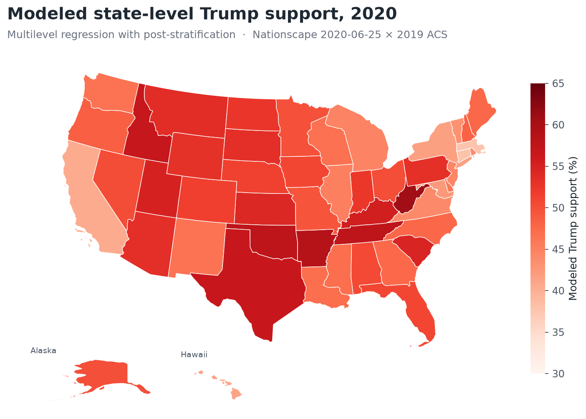
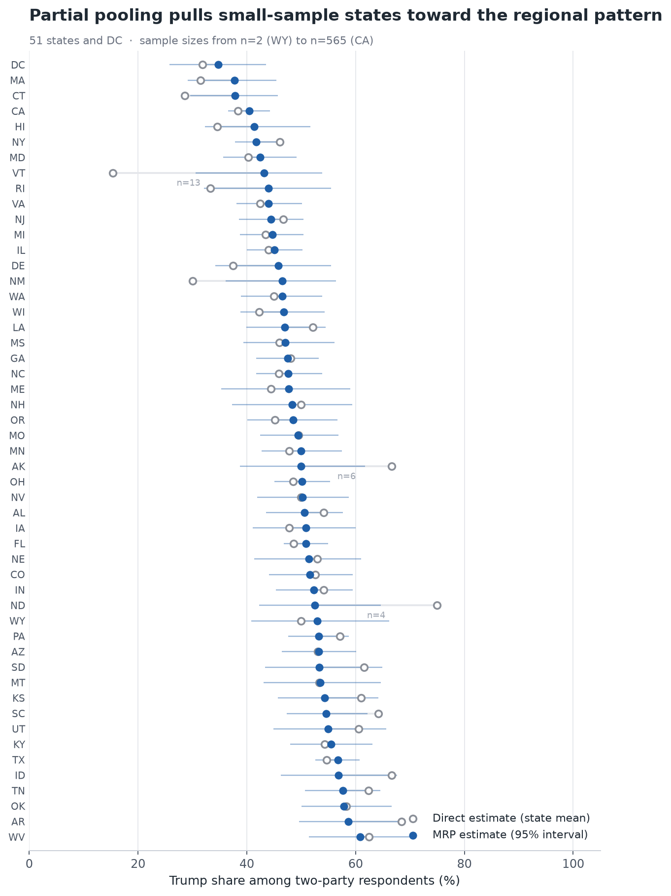

<div align="center">

# American Election Prediction 2020

**State-Level Support Estimation with MRP** · 多层回归与后分层复刻

用一份高度非代表性的在线调查，配合人口普查微观数据，
估计美国 51 个州（含哥伦比亚特区）成年人对总统候选人的支持倾向。

[](https://www.python.org/)
[](https://www.pymc.io/)
[](https://python.arviz.org/)
[](https://jupyter.org/)
[](LICENSE)

[](https://doi.org/10.1016/j.ijforecast.2014.06.001)
[](#数据来源)

**一次完整、可运行、从原始微观数据到州级估计的 MRP 流程实现。**
不需要额外配置推理引擎，不需要手工整理分类变量，
`git clone` 之后按下方「快速开始」下载数据即可复现全部结果。

</div>

---

## 目录

- [项目简介](#项目简介)
- [方法原理](#方法原理)
  - [为什么需要后分层](#为什么需要后分层)
  - [第一阶段多层回归](#第一阶段多层回归)
  - [第二阶段后分层](#第二阶段后分层)
- [结果](#结果)
  - [州级估计](#州级估计)
  - [部分汇聚的作用](#部分汇聚的作用)
  - [小群体估计](#小群体估计)
- [快速开始](#快速开始)
- [项目结构](#项目结构)
- [数据来源](#数据来源)
- [参考文献](#参考文献)
- [许可](#许可)
- [致谢](#致谢)

---

## 项目简介

民意调查有一个长期矛盾：**能做大的样本往往不具代表性，有代表性的样本往往做不大。**

传统的解法是「直接分解」（disaggregation）——把全国调查按州切开，各州内取平均。
但它对每个州、每个亚群体都当作独立样本处理，在样本量小的州和小群体上会被随机波动彻底主导。
想靠堆样本解决，需要十年以上的全国调查累积。

**MRP（Multilevel Regression with Post-stratification，多层回归与后分层）** 换了一个思路：

1. 不去估「某个州有多少人支持」，而是估「**什么样的人**支持」——用多层模型学习人口特征与支持倾向的关系；
2. 再用**人口普查的真实人口结构**，把「每种人的预测」加权汇总回每个州。

多层模型的部分汇聚（partial pooling）让稀疏单元格能够借助相似单元格的信息，
因此即便是某州只有两三个受访者、某个人群在某州没有任何受访者，也能给出稳定估计。

本项目把这套方法完整落地在 **2020 年美国大选**上：以 2020 年 6 月的 Nationscape 全国在线调查为样本，
以 2019 年 ACS 微观数据为后分层框架，输出 51 个州的点估计与 95% 可信区间。

### 一览

| | |
|---|---|
| **样本** | 5,200 位明确回答 Trump / Biden 的受访者（原始 6,479 条，其余为未决定、不投票、其他候选人） |
| **模型单元格** | 1,815 个（州 × 种族 × 性别 × 年龄 × 教育） |
| **后分层单元格** | 6,342 个，加权成年人口 255,327,593 |
| **全国加权估计** | 48.2%（样本内两党占比 47.71%） |
| **州间离散度** | 直接分解标准差 **11.35** → MRP **5.69** |
| **州级极差** | 15.4–75.0% → **34.8–60.9%** |
| **中位 95% 区间宽度** | 16.14 个百分点（最窄 CA，n=565，7.7pp；最宽 WY，n=2，25.4pp） |
| **运行时间** | 约 2 分钟（含数据读取与采样） |

---

## 方法原理

### 为什么需要后分层

设第 $j$ 个单元格的人口规模为 $N_j$，单元格内的支持率为 $\hat y_j$。
直接分解的估计量是

$$
\hat y^{\text{disagg}} = \frac{1}{\sum_j N_j}\sum_j N_j\,\hat y_j
\quad\text{其中 } \hat y_j \text{ 为该单元格内的样本均值}
$$

问题在于：单元格越细，$\hat y_j$ 越不稳。本项目的样本里，
**WY 只有 2 位两党受访者，ND 只有 4 位，AK 只有 6 位**——
直接分解会给出 WY 50.0%、ND 75.0%、AK 66.7% 这样的数字，其中大部分是噪声。
而像「某州的黑人男性」这样的单元格，很多州**根本没有受访者**，直接分解直接失效。

### 第一阶段多层回归

把人口特征完全相同的受访者聚合为二项观测 $(y, n)$，避免逐位建模。
对第 $i$ 个单元格，

$$
y_i \sim \mathrm{Binomial}\big(n_i,\; p_i\big)
$$

$$
\operatorname{logit}(p_i) =
\alpha
+ \alpha^{\text{state}}_{i}
+ \alpha^{\text{race}\times\text{gender}}_{i}
+ \alpha^{\text{age}}_{i}
+ \alpha^{\text{edu}}_{i}
+ \alpha^{\text{age}\times\text{edu}}_{i}
$$

其中各层效应均设定为零均值的层级先验，方差由数据估计：

$$
\alpha^{\text{group}} \sim \mathcal{N}\!\left(0,\ \sigma^2_{\text{group}}\right),
\qquad \sigma_{\text{group}} \sim \mathrm{HalfNormal}(1)
$$

州效应并非独立，而是**围绕所属人口普查区的效应收缩**，这正是「多层」所在：

$$
\alpha^{\text{state}}_s \sim \mathcal{N}\!\left(\alpha^{\text{region}}_{r(s)},\ \sigma^2_{\text{state}}\right),
\qquad
\alpha^{\text{region}}_r \sim \mathcal{N}\!\left(0,\ \sigma^2_{\text{region}}\right)
$$

这一结构使得某州样本较少时，其估计会适度向同地区的整体模式靠拢，而不是完全依赖那几条观测。

### 第二阶段后分层

对后分层框架中的每个单元格 $j$，代入后验参数算出支持概率 $p_j$；
再用该单元格在 **ACS 中的人口规模** $N_j$ 加权汇总到州级 $s$：

$$
\hat y^{\text{MRP}}_s
= \frac{\sum_{j \in J_s} N_j\, \mathbb{E}[p_j \mid \text{data}]}{\sum_{j \in J_s} N_j}
$$

由于每个后验抽样都能算出各自的 $\hat y^{\text{MRP}}_s$，
**可信区间是直接对后验分布取分位数得到的**，而不是二项模拟的近似。
小群体（如黑人男性）用同一套后验参数、只把求和范围限制在对应单元格上即可。

---

## 结果

### 州级估计



模型化支持倾向最高的五个州为 **WV 60.9%**、**AR 58.7%**、**OK 57.9%**、**TN 57.7%**、**ID 56.9%**，
最低的五个州为 **DC 34.8%**、**MA 37.7%**、**CT 37.9%**、**CA 40.4%**、**HI 41.3%**。

### 部分汇聚的作用



这张图是整个方法最直观的展示。灰圈为直接分解，蓝点为 MRP，蓝色细线为 95% 可信区间：

- 修正幅度与样本量**反向相关**，相关系数 $\operatorname{corr}\big(|\hat y^{\text{disagg}}-\hat y^{\text{MRP}}|,\ 1/n\big) = 0.338$；
- 修正最剧烈的是小样本州：**VT**（n=13）15.4% → **43.2%**，**ND**（n=4）75.0% → **52.5%**，**AK**（n=6）66.7% → **50.0%**；
- 样本量大的州几乎不动：CA（n=565）38.4% → 40.4%，FL（n=420）48.6% → 50.9%；
- 州间标准差从 11.35 收窄到 5.69，区间宽度随样本量单调变化——两者都说明模型在做它该做的事。

### 小群体估计

这是 MRP 相对直接分解优势最大的地方。以「黑人男性对 Trump 的支持率」为例：

| | 直接分解 | MRP |
|---|---|---|
| 覆盖州数 | 36 / 51 | **51 / 51** |
| 州间标准差 | 30.7 pp | **4.0 pp** |
| 数值极差 | 0.0 – 100.0% | **11.4 – 28.7%** |

直接分解有 15 个州**完全没有黑人男性受访者**，余下的州里也存在 0% 和 100% 这样的极端值；
MRP 借助种族×性别交互项与州效应的部分汇聚，为全部 51 个州给出稳定估计。
在两者都覆盖的 36 个州上，两种方法的估计平均相差 **23.6 个百分点**。

---

## 快速开始

### 1. 环境

```bash
pip install pandas numpy scipy matplotlib bokeh pymc arviz ipykernel
```

本项目基于 PyMC 6.x + ArviZ 1.x

### 2. 获取数据

数据受各自授权条款限制，未随仓库分发，需自行申请下载，详见 [数据来源](#数据来源)。

### 3. 放置目录

```text
American-Election-Prediction-2020-MRP/
├── ns20200625/
│   └── ns20200625.dta                          # Nationscape 2020-06-25
├── usa_00001/
│   └── usa_00001.dta                           # IPUMS USA 2019 ACS extract
└── American Election(2020) Prediction_MRP.ipynb
```

Notebook 会自动在**当前目录**与**上一级目录**中寻找这两个数据文件夹，
从仓库根目录或其父目录启动 Jupyter 都能正确解析。数据缺失时会以明确的
`AssertionError` 打印期望路径，而不是静默失败。

### 4. 运行

自上而下执行全部单元格。结果会写入 `outputs/state_estimates.csv`：

| 字段 | 含义 |
|---|---|
| `state` | 州（两字母缩写，含 DC） |
| `n` | 该州两党受访者样本量 |
| `raw_percent` | 直接分解估计（州内样本均值 × 100） |
| `mrp_percent` | MRP 后分层估计（%） |
| `mrp_low` / `mrp_high` | 95% 可信区间下界 / 上界（%） |

> 也可以直接打开 `American Election(2020) Prediction_MRP.html` 查看完整渲染结果，
> 无需安装任何依赖。

---

## 项目结构

```text
American-Election-Prediction-2020-MRP/
├── American Election(2020) Prediction_MRP.ipynb    # 主 Notebook：数据处理、建模、结果与绘图
├── American Election(2020) Prediction_MRP.html     # 静态导出，自包含（图表以 SVG 内嵌）
├── outputs/
│   └── state_estimates.csv                         # 51 个州的最终估计表
├── assets/
│   ├── state_level_trump_support.png
│   └── mrp_vs_disaggregation.png
├── README.md
├── LICENSE
└── .gitignore
```

Notebook 的结构对应分析的完整链路：

```text
调查数据读取 → 统一分类口径 → 直接分解估计 → 多层回归建模
                    ↓
        ACS 后分层框架 → 人口加权汇总 → 州级估计 + 可信区间
                    ↓
           小群体估计 → 结果导出与图表
```

---

## 数据来源

本项目的结果完全建立在以下两个数据库之上。**两者均为申请制授权数据，未随仓库分发。**

### Nationscape

| | |
|---|---|
| **全称** | *Nationscape: 2020 U.S. Election Study* |
| **发布方** | UCLA / Democracy Fund Voter Study Group |
| **官网** | https://www.voterstudygroup.org |
| **本项目使用** | `ns20200625.dta`（2020 年 6 月 25 日当周，phase 2 v20200814） |
| **使用字段** | `vote_2020`, `race_ethnicity`, `education`, `state`, `gender`, `age` |
| **获取方式** | 官网 → `Nationscape` → `GET THE LATEST NATIONSCAPE DATA` → 提交申请 → 邮件下载链接 |

这是一份大规模在线便利样本，人口结构与真实选民存在系统性偏差，正是 MRP 要修正的对象。

### IPUMS USA

| | |
|---|---|
| **全称** | *IPUMS USA: Version 16.0*（Integrated Public Use Microdata Series） |
| **发布方** | University of Minnesota, Minneapolis, MN: IPUMS |
| **官网** | https://usa.ipums.org |
| **DOI** | [10.18128/D010.V16.0](https://doi.org/10.18128/D010.V16.0) |
| **本项目使用** | 2019 年 ACS 单年样本（extract `usa_00001.dta`） |
| **使用字段** | `STATEICP`, `SEX`, `AGE`, `EDUC`, `RACE`, `PERWT` |
| **获取方式** | 注册账号 → `Select Samples` 只保留 2019 ACS → 选取上述变量 → 购物车中格式改为 `.dta` → 提交 |

用作后分层框架：`PERWT`（个人权重）的求和 **就是** 每个单元格在总体中的规模 $N_j$。
使用权重而非记录条数，是保证后分层不把 ACS 的抽样设计误当成真实人口结构的关键。

> **为什么不用原始记录数？** 一条 ACS 记录代表 `PERWT` 个真实的人。若直接数记录条数，
> 相当于假设 ACS 是等概率简单随机样本，会把各单元格的人口规模估错。

---

## 参考文献

本项目的统计方法完整实现自下面这篇论文：

> **Wang, W., Rothschild, D., Goel, S., & Gelman, A. (2015).**
> **Forecasting elections with non-representative polls.**
> *International Journal of Forecasting*, 31(3), 980–991.
> https://doi.org/10.1016/j.ijforecast.2014.06.001

```bibtex
@article{wang2015forecasting,
  title   = {Forecasting elections with non-representative polls},
  author  = {Wang, Wei and Rothschild, David and Goel, Sharad and Gelman, Andrew},
  journal = {International Journal of Forecasting},
  volume  = {31},
  number  = {3},
  pages   = {980--991},
  year    = {2015},
  doi     = {10.1016/j.ijforecast.2014.06.001}
}
```

论文的核心主张是：经过恰当的后处理，非代表性样本可以产出与代表性调查同等准确的选举预测。
它以 2012 年美国大选期间 Xbox 平台上的 75 万份访谈为数据，通过 MRP 得到国家级与州级预测，
并系统性地与实际选举结果、出口民调、预测市场进行比对。

本项目复用了论文的方法框架（多层逻辑斯蒂回归 + 后分层、部分汇聚、小群体估计），
但**替换了数据与年份**：以 2020 年的 Nationscape 调查与 2019 年 ACS 重新实施，
并在此基础上补充了后验可信区间与全部 51 个州的完整估计表。

**数据引用**

> Steven Ruggles, Sarah Flood, Matthew Sobek, Daniel Backman, Annie Chen, Grace Cooper,
> Stephanie Richards, Renae Rodgers, and Megan Schouweiler.
> *IPUMS USA: Version 16.0* [dataset]. Minneapolis, MN: IPUMS, 2025.
> https://doi.org/10.18128/D010.V16.0

> UCLA / Democracy Fund Voter Study Group.
> *Nationscape: 2020 U.S. Election Study* [dataset].
> https://www.voterstudygroup.org

---

## 许可

本仓库的**代码与文档**采用 [MIT License](LICENSE) 发布。

**原始数据不在授权范围内**，也未随本仓库分发。
`ns20200625.dta` 与 `usa_00001.dta` 分别受 Nationscape 与 IPUMS USA 的使用条款约束，
其中 IPUMS USA 为注册授权数据，其条款不允许再分发。复现请按 [数据来源](#数据来源) 自行申请。

---

## 致谢

本项目的分析与可视化框架参考自课程练习
*Multilevel Regression with Post-stratification*，并在此基础上重构、迁移至 PyMC 6 与 ArviZ 1。

统计方法的原始出处为 [Wang et al. (2015)](#参考文献)，
数据来自 [Nationscape](https://www.voterstudygroup.org) 与 [IPUMS USA](https://usa.ipums.org)。

<div align="center">
<br>
<sub>Built with PyMC · ArviZ · pandas · matplotlib</sub>
</div>
